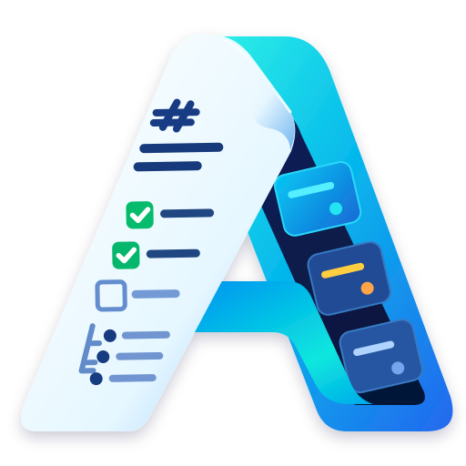
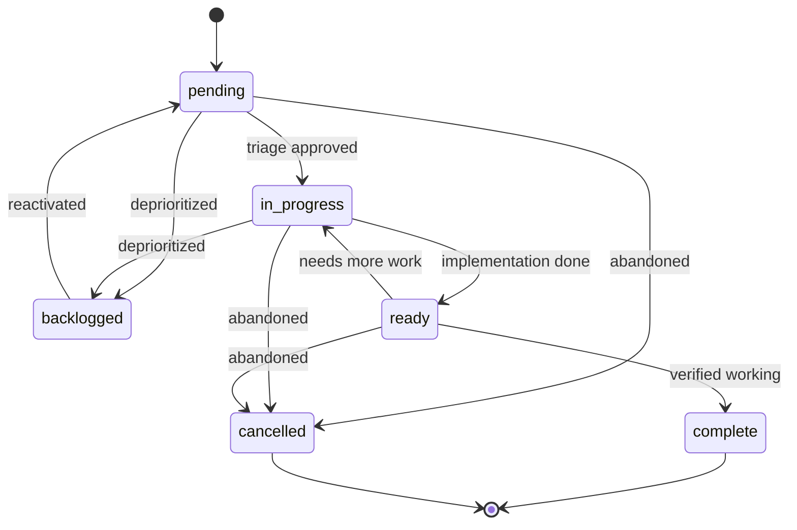

<h1>gendo</h1>


Agendo is a VS Code extension for managing Markdown-backed engineering work. Todos stay as ordinary
files in your workspace, while the Activity Bar tree, board, work-session canvas, and optional
code-scanning imports provide a workflow around them.

## Why Agendo

- Markdown files remain the source of truth and can be edited with any tool
- Status and priority stay synchronized across filenames, frontmatter, and lifecycle folders
- Tree and board views support filtering, grouping, dependencies, and focused work
- Digests summarize next actions, blockers, and recent changes; duplicate IDs are surfaced instead of guessed
- Optional CodeQL and SonarQube imports bring findings into the same workflow

## Install and get started

Download a `.vsix` from [GitHub Releases](https://github.com/JakeRoxs/agendo/releases). Releases may
be pre-release builds. In VS Code, open **Extensions**, select **...**, choose **Install from
VSIX...**, and select the downloaded file.

To start using Agendo:
1. Open **Agendo** from the Activity Bar
2. Keep the default todo root, `docs/todos`, or choose another root in Settings
3. Select **Create Todo...**, enter a short description, choose a priority, and optionally add an
   external key
4. Open the new Markdown file from the tree or board and begin work

The tree and board show the same files in different ways. Use **Open Board** for status columns, or
open a todo in the work-session canvas for its criteria, blockers, resume context, and work log.

## Todo file convention

Todos are stored as Markdown files under a configured root folder, usually `docs/todos` by default.

```text
{issue_id}-{status}-{priority}-{description}.md
```

Examples:

```text
001-pending-p2-write-readme.md
002-in-progress-p1-fix-n-plus-1.md
003-ready-p1-verify-n-plus-1-fix.md
```

The naming convention includes:
- `issue_id` — zero-padded, sequential, and unique
- `status` — `pending`, `in-progress`, `ready`, `backlogged`, `complete`, or `cancelled`
- `priority` — `p1`, `p2`, or `p3`
- `description` — kebab-case text

Lifecycle semantics:
- `pending` needs triage or has not started
- `in-progress` is actively being worked on
- `ready` is likely done but still needs confirmation that it works
- `backlogged` remains open but is excluded from active-work queries
- `complete` is fully finished and verified
- `cancelled` is abandoned or superseded



Active todos live directly in the configured root. Backlogged, complete, and cancelled todos move
to their configured state folders. The filename status and priority tokens are authoritative;
frontmatter mirrors them for readability.

Todo files may also include optional metadata:

```yaml
tags: [release, testing]
dependencies: ["042"]
group: release
key: "JIRA-123"
```

Dependencies drive blocked-state reporting, groups provide lightweight organization, and external
tracking keys are displayed and searchable when present.

## Configuration

| Setting                                    | Default      | Description                                                                           |
| ------------------------------------------ | ------------ | ------------------------------------------------------------------------------------- |
| `agendo.root`                              | `docs/todos` | Workspace-relative todo root                                                          |
| `agendo.defaultPriority`                   | `p3`         | Default priority for new todos                                                        |
| `agendo.completeFolder`                    | `complete`   | Folder for completed todos                                                            |
| `agendo.cancelledFolder`                   | `cancelled`  | Folder for cancelled todos                                                            |
| `agendo.backlogFolder`                     | `backlog`    | Folder for backlogged todos                                                           |
| `agendo.viewMode`                          | `default`    | Open todos using VS Code default behavior, editor, preview, preview editor, or canvas |
| `agendo.groupBy`                           | `status`     | Group the regular tree by status, priority, group, or not at all                      |
| `agendo.sortByDate`                        | `false`      | Sort regular todos by modification date                                               |
| `agendo.showDependencyNodes`               | `false`      | Nest blocked todos under their blockers                                               |
| `agendo.gitignoreTodos`                    | `true`       | Ignore todo files except Agendo configuration                                         |
| `agendo.skillUpdateCheck`                  | `true`       | Notify when bundled skill or canvas versions differ                                   |
| `agendo.codeScanning.enabled`              | `false`      | Enable manual CodeQL and SonarQube imports                                            |
| `agendo.codeScanning.sortByDate`           | `false`      | Sort scanning todos by modification date                                              |
| `agendo.codeScanning.sonarqube.url`        | empty        | SonarQube server URL                                                                  |
| `agendo.codeScanning.sonarqube.projectKey` | empty        | SonarQube project key                                                                 |

## Duplicate IDs

Regular todos and each scanner source use independent ID sequences (`003`, `cql-003`, and `sq-003` are distinct). Agendo warns about duplicate IDs within a source and blocks ambiguous ID-based actions. **Copy ID Collision Reconciliation Context** prepares an evidence-backed prompt for review; it does not modify files or invoke an agent.

## Work with agents

### Agendo skill

The bundled Agendo skill helps compatible agent hosts create todos, resume interrupted work, keep
work logs, and review todos against the current codebase. Install it from the **Skill** section, then
invoke it with requests such as `/agendo triage` or `/agendo what's next`.

See [docs/skill.md](docs/skill.md) for Resume Context and the advisory reconciliation workflow.

### Work-session canvas

Open the interactive canvas from a todo's context menu or set `agendo.viewMode` to `canvas`. It edits
the same Markdown file and displays acceptance criteria, dependencies, resume context, work logs, and
navigation history. Pending todos emphasize problem context and triage; active work emphasizes
implementation progress.

### MCP server

Agendo includes a local stdio MCP server for compatible clients. Run **Agendo: Show MCP Configuration**
to open its server configuration. Tools retrieve todo context, groups, and dependencies, and can
update supported status, priority, group, and acceptance-criterion fields.

## Code Scanning

Code scanning is optional and disabled by default. Run **Agendo: Import Code-Scanning Todos...** from the Command Palette or the **Code Scanning** view. Imports are manual; activation, normal refresh, and opening a canvas do not contact GitHub or SonarQube.

### Choose source and branch

- **CodeQL** uses the current workspace repository and the authenticated GitHub CLI (`gh auth login`). Your account needs permission to read code-scanning alerts
- **SonarQube** lists project branches that have been analyzed and are available to your SonarQube edition or plan. Branch analysis may not be available on every server or plan
- Both sources offer the default branch and available branches. A todo records its selected branch, and targeted refreshes query that same branch

SonarQube authentication can use the active `sonar` CLI connection or a direct user token. The CLI path reuses `sonar auth login` without reading its stored token. Direct tokens are stored in VS Code SecretStorage, not todo files or settings. SonarQube imports unresolved issues, not Security Hotspots; the server must use HTTPS except for loopback.

### Choose grouping

| Import choice           | Creates                                                     |
| ----------------------- | ----------------------------------------------------------- |
| **By file** (default)   | One todo per affected file, with all findings for that file |
| **By rule/type**        | One todo per rule across affected files                     |
| **By individual issue** | One todo per scanner finding                                |

Re-importing the same source, branch, and grouping refreshes its scanner evidence. Other branches or groupings create separate todos. Refresh preserves todo status, priority, notes, user criteria, and work logs; findings that are no longer returned are not automatically completed or deleted.

### Views and files

CodeQL and SonarQube todos have independent `cql-` and `sq-` ID sequences under the configured todo root:

```text
docs/todos/
  001-pending-p2-regular-todo.md
  code-scanning/
    codeql/cql-001-pending-p1-src-example-ts.md
    sonarqube/sq-001-pending-p2-src-example-ts.md
```

The **Code Scanning** view and board have separate search, filters, digest, date sorting, and layout. Scanner todos still share dependencies with regular todos and can be opened in the work-session canvas. Re-import updates only the marked **Scanner Evidence** section, which includes affected locations, source links, and rule context.

## Development and packaging

Requirements for development are VS Code 1.103 or later, Node.js 22 or later, and npm.

```bash
npm ci
npm run compile
npm run test:coverage
```

Press **F5** to open an Extension Development Host, a separate VS Code window that runs the source
from this checkout. After compiling changes, run **Developer: Reload Window** in that host. This is
different from installing the packaged extension into your normal VS Code profile.

To package the current version, run:

```bash
npm run package:vsix
```

The VSIX is written to `.artifacts/agendo-<version>.vsix`. In VS Code, **Ctrl+Shift+B** runs
**Package and Install VSIX** and installs it into the profile used by the `code` command. Reload that
window to activate it. Packaging bundles the extension and MCP server and excludes the raw
`node_modules` tree.

Other useful commands:

```bash
npm run lint
npm run format
npm test
```

`npm run lint` checks lint rules; `npm run format` applies formatting. The test suite runs in the
VS Code extension test harness.

## Contributing

Contributions are welcome. Follow the existing TypeScript and VS Code extension patterns, run the
relevant tests, and keep documentation in sync with user-visible behavior. See [Issues and Pull
Requests](https://github.com/JakeRoxs/agendo/issues).

## License

This project is licensed under the MIT License. See [LICENSE](LICENSE) for details.
